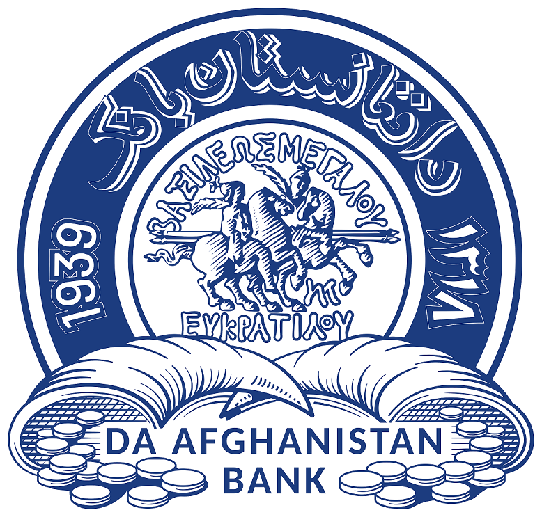
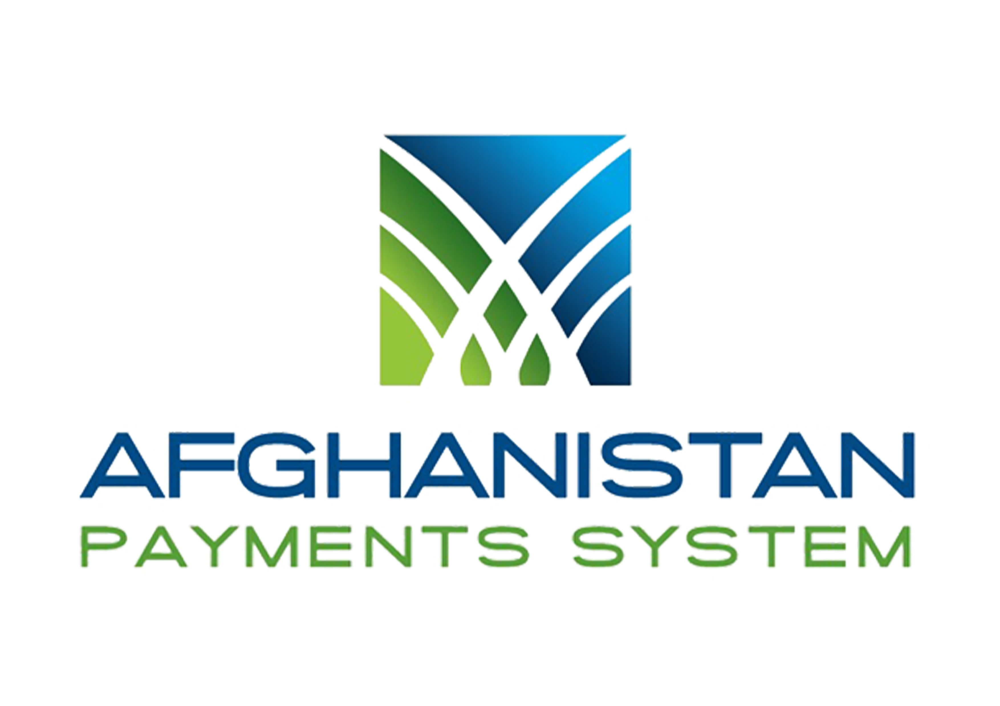

<!-- ================================================= -->
<!--              PROFESSIONAL GITHUB PROFILE           -->
<!-- ================================================= -->

<h3 align="center">
Senior Full-Stack Engineer • Enterprise Architect • Payment Systems Specialist
</h3>

<!-- ================================================= -->
<!--                     BADGES                        -->
<!-- ================================================= -->

<!-- ================================================= -->
<!--                  PROFESSIONAL SUMMARY             -->
<!-- ================================================= -->

<table>
<tr>
<td width="220">

</td>
<td align="left">

## Professional Summary

- Enterprise Web Application Development
- Banking & Payment Integration Systems
- API Gateway & Middleware Architecture
- Microservices & Distributed Systems
- Mobile & Web Platform Engineering
- Secure Authentication & IAM Systems
- Cloud Infrastructure & DevOps

</td>
</tr>
</table>

<!-- ================================================= -->
<!--                 FOUNDER & CEO                     -->
<!-- ================================================= -->

<h2 align="center">Founder & CEO — <a href="https://qachmas.com/">Qachmas Intelligence</a></h2>

<table>
<tr>
<td align="center" width="700">

<em>Qachmas Intelligence</em> is a technology-driven company focused on building modern digital solutions — delivering enterprise-grade software, secure payment systems, cloud infrastructure, and scalable web & mobile platforms. It blends deep engineering expertise with a commitment to innovation, reliability, and secure digital transformation for businesses and institutions.

</td>
</tr>
</table>

<!-- ================================================= -->
<!--                     EXPERIENCE                    -->
<!-- ================================================= -->

<h2 align="center">Professional Experience</h2>

<table>
<tr>
<td align="center" width="220">
  
<b>Balkh University</b> 
Assistant Professor & Software Engineer
</td>
<td align="center" width="220">
  
<b>Da Afghanistan Bank</b> 
Senior Manager, Systems Development & Applications
</td>
<td align="center" width="220">
  
<b>Afghanistan Payments System (APS)</b> 
Lead Full-Stack Engineer
</td>
</tr>
</table>

